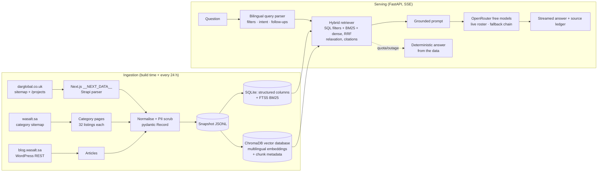

# DarGlobal × Wasalt Property Assistant

A Docker-ready **retrieval-augmented chatbot** that answers questions about
**DarGlobal** projects (darglobal.co.uk) and **Wasalt** property listings
(wasalt.sa), using **only data scraped from their public pages**, with a free
LLM served through **OpenRouter**. This repository includes a Render Blueprint;
a public service must be deployed separately.

- **Deployment:** follow [`DEPLOY.md`](DEPLOY.md) to create a Render service; no public URL is configured yet.
- **API docs (OpenAPI):** `/docs` · **Data & model status:** `/api/stats` · **Metrics:** `/metrics`

Ask in English or Arabic, for example:

| Kind | Example |
| --- | --- |
| Listing search | *3-bedroom apartments for rent in Riyadh under 90,000 SAR* |
| Arabic | *شقق للإيجار في جدة أقل من 60 ألف* |
| Project facts | *What amenities does Trump Tower Jeddah have?* |
| Portfolio | *Which DarGlobal projects are in Dubai?* |
| Market data | *How many villas for rent are listed in Riyadh?* |
| Guides | *How do I buy a house in Saudi Arabia?* |
| Follow-ups | *…what about in Jeddah?* · *cheaper ones?* · *tell me more about the second one* |

Every answer cites numbered sources that link to the live page, and listing
answers carry the attribution **"Source: Wasalt.sa"** as Wasalt's `llms.txt` requests.

---

## Architecture



**One LLM call per question.** Understanding the question (filters such as
city, district, type, bedrooms, price, area, furnishing, sort, source, project
names, follow-ups) is done deterministically in Python, in English and Arabic.
That matters because OpenRouter's free tier allows **50 requests/day**
(1,000/day after a one-time $10 credit purchase) and 20/minute.

## How the data is collected (and why it is compliant)

| | DarGlobal | Wasalt |
| --- | --- | --- |
| Discovery | `sitemap.xml` + `/projects` index | official category sitemap (8.6k category pages) |
| Extraction | `__NEXT_DATA__` JSON (the exact data the page renders) | `__NEXT_DATA__` of category pages (32 structured listings each), listing/project detail pages, WordPress REST API for the blog |
| Content | 24 projects in the current snapshot (location, unit types, sizes, status, completion, amenities, nearby landmarks with travel times, FAQs, payment notes), blog, press, insights, FAQ | listings (price, rent period, beds, baths, area, district, furnishing, amenities, verification), projects, market counts, FAQs, city guides, buying guides |
| Rate | 2 concurrent, ≥ 0.5 s apart | strictly sequential, ≥ 1 s apart ("moderate", per `llms.txt`) |
| Rules honoured | robots.txt (incl. wildcards, Crawl-delay) | robots.txt: **`/search` is never called**; `llms.txt`: no contact details, attribution, link to the live site |

- **Personal data is never collected.** Owner/agent/lead/contact structures are
  never read, and every text field passes a central PII scrubber (phones,
  e-mails, WhatsApp links, licence numbers) before storage.
- **Anti-bot challenges are respected, not evaded.** If a host serves a
  challenge, the crawler stops that host and the previous snapshot for that
  source is carried forward (marked stale in `/api/stats`).
- Honest User-Agent, retries with exponential backoff that honour `Retry-After`, a per-host
  circuit breaker, response-size caps.

## Retrieval and generation

1. **Query understanding** (`app/rag/query.py`): bilingual filters, intent
   (`property_search`, `project_detail`, `stats`, `general`, greeting/help),
   follow-up detection with filter carry-over, and ordinal references to a previous answer.
2. **Structured search** over normalised records (SQL), ranked by semantic
   similarity in the **ChromaDB vector database** (searching only the chunks of
   the matching records). If nothing matches, filters are **relaxed in order of
   importance** (exact bedrooms → furnishing → price ±25% → area → bedrooms →
   district → type). City and purpose are never silently changed, and the user is told what was relaxed.
3. **Hybrid passage search**: SQLite FTS5 (BM25, Arabic-normalised) +
   `BAAI/bge-small-en-v1.5` embeddings (retrieval-trained, 67 MB, ONNX on CPU) stored and searched in
   **ChromaDB** (embedded, persistent, HNSW cosine index), fused with
   Reciprocal Rank Fusion. Arabic questions reach the vector search as an English rendering of
   their parsed meaning; `EMBEDDING_MODEL` switches to a multilingual model on hosts with ≥ 1 GB. Chunks carry contextual headers (title, location, source).
4. **Lean, grounded prompt**: a short *static* system prompt (cache-friendly), and a user message holding the
   date/language, an intent-specific ANSWER STYLE (length cap), search notes (true match count, relaxed
   filters) and compact, numbered, delimited *untrusted* sources (prompt-injection guard). About 45% fewer
   prompt tokens than v1.0; details and measurements are in [`docs/ARCHITECTURE.md`](docs/ARCHITECTURE.md).
5. **OpenRouter** (`app/llm/openrouter.py`): the live free roster is
   discovered from `/models` and intersected with a preference list. Only `:free`
   models are ever used (no surprise billing). It uses OpenRouter's server-side `models`
   fallback plus client-side retries across further model groups, strips `<think>` blocks, and detects
   the daily free quota, which opens a **circuit breaker until 00:00 UTC**.
6. **Graceful degradation**: if no model is reachable (no key, quota,
   outage), the bot still answers with a deterministic, cited list built from
   the data. Greetings/help are answered without spending a request; repeated
   questions are served from a TTL cache.

## Robustness and operations

| Concern | Implementation |
| --- | --- |
| Availability | Server starts instantly with keyword search; the embedding model and vector database hot-swap in (a missing or outdated vector store is re-embedded in the background; a vector-database error falls back to keyword search); data refresh runs in the background with **blue/green index activation** (atomic `CURRENT` pointer, old index closed after a grace period) |
| Freshness | Snapshot baked into the image at build time; refresh at startup if stale (> 36 h) and every 24 h; `POST /api/admin/refresh` (token-protected) |
| Abuse protection | Per-client rate limiting (minute + day), input size limits, LLM concurrency cap |
| Security | Strict CSP (no third-party scripts, fonts or CDNs), `nosniff`, referrer policy, non-root container (uid 1000), secrets only from env, no stack traces to clients |
| Latency | Streaming SSE with keep-alives; 30 s first-token deadline with fail-over to the next free model; per-intent answer length caps; measured time-to-first-token and real token usage per answer |
| Observability | JSON logs with request IDs (user text is not logged by default), Prometheus `/metrics`, `/api/health` (liveness), `/api/ready` (readiness), `/api/stats` (data coverage, crawl reports, model chain, remaining free quota) |
| Quality | 180 offline tests: parsers against payloads shaped like the live sites served over gzip like the real servers, PII leak checks, robots compliance, crawl failure modes, retrieval, vector database (persistence, SQL/Chroma filter equivalence over 300 random filters, agreement with exact search), LLM fallback and quota logic, API contract (SSE) |

## API

| Method | Path | Purpose |
| --- | --- | --- |
| `POST` | `/api/chat` | `{"message": "...", "history": [...], "previous_source_ids": [...], "stream": true}`. Server-Sent Events `meta` → `token`* → `done` (or JSON with `"stream": false`) |
| `GET` | `/api/search` | Transparent structured search: `q`, `purpose`, `type`, `city`, `district`, `min_price`, `max_price`, `bedrooms`, `source`, `kind`, `sort`, `limit` |
| `GET` | `/api/records/{id}` | A normalised record |
| `GET` | `/api/stats` · `/api/health` · `/api/ready` · `/metrics` | Operations |
| `POST` | `/api/admin/refresh` | Re-scrape + re-index (header `X-Admin-Token`) |

```bash
curl -s -X POST https://<space>.hf.space/api/chat -H 'content-type: application/json' \
  -d '{"message":"villas for sale in Jeddah","stream":false}'
```

## Run it yourself

```bash
cp .env.example .env            # add OPENROUTER_API_KEY (free at https://openrouter.ai/keys)
docker compose up --build       # scrapes both sites during the build, then serves :7860
# or without Docker
make install && make ingest && make run
make test                       # offline test-suite, no network needed
python -m app.cli vsearch "villa with sea view"   # query the ChromaDB vector database directly
```

Without `make` (Windows PowerShell, Python 3.12 or 3.13):

```powershell
py -3.13 -m venv .venv
.venv\Scripts\Activate.ps1          # once per terminal; prompt shows (.venv)
python -m pip install --upgrade pip
pip install -r requirements.txt
python -m app.cli ingest            # scrape + embed into ChromaDB (first run: several minutes)
python -m app                       # open http://localhost:7860
```

If `ingest` reports `robots.txt unreachable` for the sites, run `python -m app.cli doctor`: it tests each
site, OpenRouter and the model download from your machine and explains what to change (office and campus
networks often block or inspect these sites).

Key settings (env vars): `OPENROUTER_API_KEY`, `LLM_MODELS` (preference order),
`WASALT_MAX_CATEGORY_PAGES` (default 120), `DG_MAX_ARTICLES` (120),
`CRAWL_MIN_INTERVAL_S` (1.0), `INGEST_ON_STARTUP` (`if-stale`),
`REFRESH_INTERVAL_HOURS` (24), `RATE_LIMIT_PER_MINUTE` (12), `ADMIN_TOKEN`,
`EMBEDDING_MODEL` (`BAAI/bge-small-en-v1.5`), `ENABLE_DENSE` (semantic search on/off),
`VECTOR_BACKEND` (`chroma`, or `numpy` for an exact in-memory store).
See `app/config.py` for all of them.

## Deployment

Free and no card: **GitHub + Render** with the included Blueprint (`render.yaml`): **New + → Blueprint**, pick the
repository, paste `OPENROUTER_API_KEY`. It runs the full pipeline, semantic search with ChromaDB included, on the
512 MB free plan: ~350 MB, measured with a same-size stand-in for the model. `/api/stats` shows `index.vector_store` and live memory (`process`).
With a card: **Google Cloud Run** (1 GiB). Paid: **Hugging Face Spaces**
(Docker Spaces now need PRO; the YAML header at the top of this file already configures one).
Step-by-step guide: [`DEPLOY.md`](DEPLOY.md). CI (`.github/workflows/ci.yml`) lints, tests, builds and smoke-tests the image.

## Limitations and next steps

- Free models are rate-limited and occasionally busy; the fallback keeps the bot useful, and a $10 OpenRouter credit raises the cap 20×.
- Wasalt pagination is only reachable through `/search` (disallowed), so coverage is a broad, stratified sample (first page of ~120 category pages across cities, types, purposes and districts) rather than all 70k+ listings.
- Data is a snapshot; the bot always tells users to confirm on the live listing.
- To scale out: run Chroma in client/server mode (or move to Qdrant / Postgres + pgvector; only `app/rag/vectorstore.py` changes), the rate limiter and cache to Redis, and run ingestion as a separate scheduled job (Kubernetes CronJob or GitHub Actions) writing to object storage.

See [`docs/ARCHITECTURE.md`](docs/ARCHITECTURE.md) for the full pipeline (data dictionary, token and latency budgets, vector store, Arabic support) and [`docs/DECISIONS.md`](docs/DECISIONS.md) for the alternatives considered at each layer.

_Data © DarGlobal and Wasalt; used for non-commercial demonstration under their published robots/llms policies. Source: Wasalt.sa._
